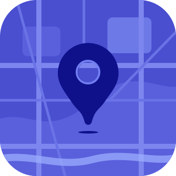

<p>

</p>

# Craft Geo Maps

Geo maps is a full-featured geo field for Craft CMS — with search, GeoJSON editing, GraphQL, and more.

## Features
- Works out of the box with OpenStreetMap — or add a Google key for Google tiles, Places search and static maps.
- One-click import from Maps (ether/simplemap): fields, content and templates carry over.
- Search by Location: Filter entries by proximity to a given location. Sort by distance and display results on a map.
- GeoJson Editing: Edit and manage GeoJson data directly within the Craft control panel.
- Feature Editor panel with Properties, GeoJSON tabs.
- Map Rendering: Static and Dynamic map rendering options. 
- Address Autocomplete: Integrated address autocomplete for easy location entry.      
- GraphQL Support: Full GraphQL support for headless Craft projects, with location-based querying built in.
- Feed Me support: Full Feedme support for projects. Full compatibility with Craft's Feed Me plugin

## Requirements

This plugin requires Craft CMS 5.10.0 or later, and PHP 8.2 or later.

## Installation

You can install this plugin from the Plugin Store or with Composer.

#### From the Plugin Store

Go to the Plugin Store in your project’s Control Panel and search for "Geo Maps". Then press “Install”.

#### With Composer

Open your terminal and run the following commands:

```bash
# go to the project directory
cd /path/to/my-project.test

# tell Composer to load the plugin
composer require suprim/craft-geomaps

# tell Craft to install the plugin
./craft plugin/install geo
```


## Example Usage

```twig



    <h2>{{ map.lat }} {{ map.lng }}</h2>
    <p>{{ map.full_address }}</p>   

```

## License

Geo Maps is licensed under the [Craft License](LICENSE.md). Bundled open-source libraries are listed in [THIRD-PARTY-LICENSES.md](THIRD-PARTY-LICENSES.md).
